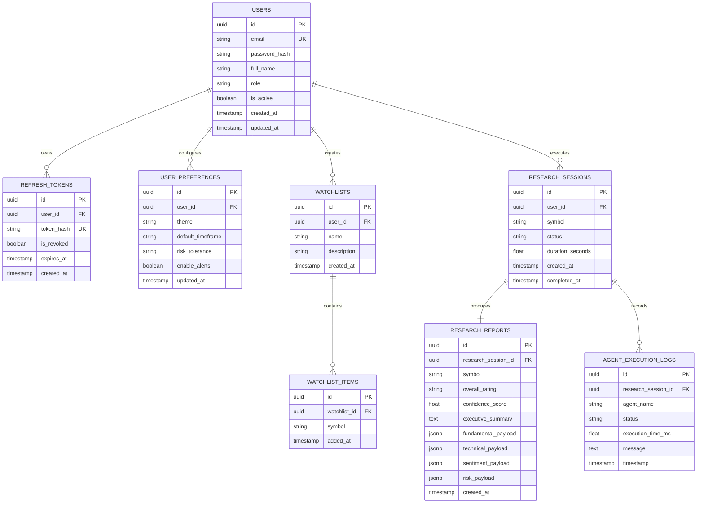

# API AND INTEGRATION SPECIFICATION
**Project Title:** AI-Powered Multi-Agent System for Market Analysis and Research  
**Document Identifier:** API-INT-MASRA-V1.0  
**Status:** Approved Technical Contract  
**Classification:** REST API Contracts, Database Schema & External Integrations  

---

## 1. REST API Architectural Standards

### 1.1 Base URL & Versioning
- **Base URL:** `https://api.stock-analyst.internal/api/v1` (Production) / `http://localhost:8000/api/v1` (Local Dev)
- **Versioning Strategy:** URI versioning (`/v1/`). Breaking schema changes require a new version path (`/v2/`).

### 1.2 Authentication & Security Headers
All protected endpoints require an HTTP `Authorization` header containing a valid Bearer JSON Web Token:
```http
Authorization: Bearer <jwt_access_token>
```
Standard security headers enforced across all responses:
```http
Content-Type: application/json; charset=utf-8
X-Content-Type-Options: nosniff
X-Frame-Options: DENY
Strict-Transport-Security: max-age=31536000; includeSubDomains
```

### 1.3 Standard HTTP Status Codes

| Code | Status | Meaning in System Context |
| :---: | :--- | :--- |
| **200** | `OK` | Request succeeded; response payload contains requested entity. |
| **201** | `Created` | Resource successfully created (User registered, Watchlist created). |
| **202** | `Accepted` | Asynchronous task initiated (Multi-agent research session started). |
| **204** | `No Content` | Request succeeded with no entity body returned (Resource deleted). |
| **400** | `Bad Request` | Malformed request syntax or invalid query parameters. |
| **401** | `Unauthorized` | Missing, expired, or invalid JWT authentication token. |
| **403** | `Forbidden` | Authenticated user lacks permission to access target resource. |
| **404** | `Not Found` | Target ticker, research session, report, or user not found. |
| **409** | `Conflict` | Resource conflict (e.g., email already registered, stock already in watchlist). |
| **422** | `Unprocessable Entity` | Pydantic validation failure on request payload. |
| **429** | `Too Many Requests` | Rate limit threshold exceeded. Includes `Retry-After` header. |
| **500** | `Internal Server Error` | Unhandled server exception. Triggers error logging. |
| **503** | `Service Unavailable` | External market data provider or LLM service unreachable. |

### 1.4 Unified Error Response Contract (RFC 7807)
All error responses adhere to a consistent JSON structure:
```json
{
  "error": {
    "code": "SYMBOL_NOT_FOUND",
    "message": "The ticker symbol 'INVALID' is not a recognized US equity.",
    "details": [
      {
        "field": "symbol",
        "issue": "Ticker symbol must be 1 to 5 alphabetic characters."
      }
    ],
    "timestamp": "2026-11-17T01:15:00Z",
    "request_id": "req_8f92b7c1"
  }
}
```

### 1.5 Pagination & Filtering Standards
List endpoints support standardized query parameters:
- `page` (integer, default: `1`, minimum: `1`)
- `page_size` (integer, default: `20`, maximum: `100`)
- `sort_by` (string, e.g., `created_at`, `symbol`)
- `sort_order` (string: `asc` or `desc`, default: `desc`)

---

## 2. Comprehensive Endpoint Specifications

---

### 2.1 Authentication Endpoints (`/api/v1/auth`)

#### 1. Register Account
- **Method & URL:** `POST /api/v1/auth/register`
- **Purpose:** Create a new user account with secure Argon2id password hashing.
- **Authentication:** None (Public).
- **Request Body:**
  ```json
  {
    "email": "analyst@example.com",
    "password": "SecurePassword123!",
    "full_name": "Sophia Martinez"
  }
  ```
- **Success Response (`201 Created`):**
  ```json
  {
    "user_id": "usr_9b1deb4d-3b7d-4bad-9bdd-2b0d7b3dcb6d",
    "email": "analyst@example.com",
    "full_name": "Sophia Martinez",
    "role": "USER",
    "created_at": "2026-11-17T01:00:00Z"
  }
  ```
- **Error Responses:** `400 Bad Request` (Weak password), `409 Conflict` (Email already registered).

#### 2. User Login
- **Method & URL:** `POST /api/v1/auth/login`
- **Purpose:** Authenticate credentials and receive short-lived access and refresh tokens.
- **Authentication:** None (Public).
- **Request Body:**
  ```json
  {
    "email": "analyst@example.com",
    "password": "SecurePassword123!"
  }
  ```
- **Success Response (`200 OK`):**
  ```json
  {
    "access_token": "eyJhbGciOiJIUzI1NiIsIn...",
    "token_type": "bearer",
    "expires_in": 900,
    "refresh_token": "rt_8f1a2b3c4d5e6f7a8b9c0d1e2f3a4b5c"
  }
  ```
- **Error Responses:** `401 Unauthorized` (Invalid credentials), `429 Too Many Requests`.

#### 3. Refresh Access Token
- **Method & URL:** `POST /api/v1/auth/refresh`
- **Purpose:** Exchange a valid refresh token for a fresh access token (with token rotation).
- **Authentication:** None (Requires valid refresh token in body or HTTP-only cookie).
- **Request Body:**
  ```json
  {
    "refresh_token": "rt_8f1a2b3c4d5e6f7a8b9c0d1e2f3a4b5c"
  }
  ```
- **Success Response (`200 OK`):**
  ```json
  {
    "access_token": "eyJhbGciOiJIUzI1NiIsIn...",
    "token_type": "bearer",
    "expires_in": 900,
    "refresh_token": "rt_9a8b7c6d5e4f3a2b1c0d9e8f7a6b5c4d"
  }
  ```
- **Error Responses:** `401 Unauthorized` (Expired or revoked refresh token).

#### 4. User Logout
- **Method & URL:** `POST /api/v1/auth/logout`
- **Purpose:** Invalidate active session and blacklist the refresh token in Redis.
- **Authentication:** Bearer Token.
- **Request Body:**
  ```json
  {
    "refresh_token": "rt_9a8b7c6d5e4f3a2b1c0d9e8f7a6b5c4d"
  }
  ```
- **Success Response (`200 OK`):**
  ```json
  {
    "message": "Successfully logged out."
  }
  ```

#### 5. Get Current User Info
- **Method & URL:** `GET /api/v1/auth/me`
- **Purpose:** Retrieve the profile and session context of the currently authenticated user.
- **Authentication:** Bearer Token.
- **Success Response (`200 OK`):**
  ```json
  {
    "user_id": "usr_9b1deb4d-3b7d-4bad-9bdd-2b0d7b3dcb6d",
    "email": "analyst@example.com",
    "full_name": "Sophia Martinez",
    "role": "USER",
    "is_active": true
  }
  ```

---

### 2.2 User & Preferences Endpoints (`/api/v1/users`)

#### 6. Get User Profile
- **Method & URL:** `GET /api/v1/users/me`
- **Authentication:** Bearer Token.
- **Success Response (`200 OK`):**
  ```json
  {
    "user_id": "usr_9b1deb4d-3b7d-4bad-9bdd-2b0d7b3dcb6d",
    "email": "analyst@example.com",
    "full_name": "Sophia Martinez",
    "avatar_url": null,
    "created_at": "2026-11-17T01:00:00Z"
  }
  ```

#### 7. Update User Profile
- **Method & URL:** `PATCH /api/v1/users/me`
- **Authentication:** Bearer Token.
- **Request Body:**
  ```json
  {
    "full_name": "Sophia M. Rodriguez"
  }
  ```
- **Success Response (`200 OK`):** Returns updated User Profile DTO.

#### 8. Get User Preferences
- **Method & URL:** `GET /api/v1/users/preferences`
- **Authentication:** Bearer Token.
- **Success Response (`200 OK`):**
  ```json
  {
    "theme": "dark",
    "default_timeframe": "1Y",
    "enable_email_alerts": false,
    "default_risk_tolerance": "moderate"
  }
  ```

#### 9. Update User Preferences
- **Method & URL:** `PUT /api/v1/users/preferences`
- **Authentication:** Bearer Token.
- **Request Body:**
  ```json
  {
    "theme": "dark",
    "default_timeframe": "6M",
    "enable_email_alerts": true,
    "default_risk_tolerance": "aggressive"
  }
  ```
- **Success Response (`200 OK`):** Returns updated Preferences DTO.

---

### 2.3 Stocks & Market Data Endpoints (`/api/v1/stocks`)

#### 10. Search Stocks (Autocomplete)
- **Method & URL:** `GET /api/v1/stocks/search?q={query}&limit={limit}`
- **Authentication:** Public or Bearer Token.
- **Query Parameters:** `q` (string, min 1 char, required), `limit` (int, default 10).
- **Success Response (`200 OK`):**
  ```json
  {
    "query": "NVDA",
    "count": 1,
    "results": [
      {
        "symbol": "NVDA",
        "company_name": "NVIDIA Corporation",
        "exchange": "NASDAQ",
        "asset_type": "Common Stock",
        "currency": "USD"
      }
    ]
  }
  ```

#### 11. Get Stock Real-Time Overview
- **Method & URL:** `GET /api/v1/stocks/{symbol}`
- **Authentication:** Bearer Token.
- **Path Parameters:** `symbol` (e.g., `NVDA`).
- **Success Response (`200 OK`):**
  ```json
  {
    "symbol": "NVDA",
    "company_name": "NVIDIA Corporation",
    "exchange": "NASDAQ",
    "current_price": 142.50,
    "change_amount": 3.75,
    "change_percent": 2.70,
    "market_cap": 3500000000000,
    "pe_ratio": 48.2,
    "high_52w": 144.42,
    "low_52w": 45.20,
    "volume": 42150000,
    "source": "Polygon.io",
    "timestamp": "2026-11-17T01:10:00Z"
  }
  ```
- **Error Responses:** `404 Not Found` (Unknown ticker).

#### 12. Get Historical OHLCV Series
- **Method & URL:** `GET /api/v1/stocks/{symbol}/history?timeframe={timeframe}`
- **Authentication:** Bearer Token.
- **Query Parameters:** `timeframe` (`1M`, `3M`, `6M`, `1Y`, `5Y`, default: `1Y`).
- **Success Response (`200 OK`):**
  ```json
  {
    "symbol": "NVDA",
    "timeframe": "1Y",
    "data_points": 252,
    "series": [
      {
        "time": "2025-11-17",
        "open": 138.20,
        "high": 143.10,
        "low": 137.90,
        "close": 142.50,
        "volume": 42150000
      }
    ]
  }
  ```

---

### 2.4 Multi-Agent Research Endpoints (`/api/v1/research`)

#### 13. Trigger Multi-Agent Research Session
- **Method & URL:** `POST /api/v1/research`
- **Purpose:** Initiate an asynchronous LangGraph multi-agent research workflow.
- **Authentication:** Bearer Token.
- **Request Body:**
  ```json
  {
    "symbol": "NVDA"
  }
  ```
- **Success Response (`202 Accepted`):**
  ```json
  {
    "research_id": "res_c7b1e4f2-984a-4e2a-9e12-4c6e3b8a10d9",
    "symbol": "NVDA",
    "status": "PENDING",
    "created_at": "2026-11-17T01:12:00Z",
    "stream_url": "/api/v1/research/res_c7b1e4f2-984a-4e2a-9e12-4c6e3b8a10d9/stream"
  }
  ```
- **Error Responses:** `404 Not Found` (Invalid symbol), `429 Too Many Requests` (Quota exceeded).

#### 14. Stream Real-Time Agent Progress (SSE)
- **Method & URL:** `GET /api/v1/research/{research_id}/stream`
- **Protocol:** Server-Sent Events (`text/event-stream`).
- **Authentication:** Bearer Token (or short-lived ticket parameter).
- **Stream Event Format:**
  ```http
  event: status
  data: {"step": "FUNDAMENTAL_ANALYSIS", "agent": "fundamental", "progress": 40, "message": "Analyzing balance sheet leverage and 3-year margins..."}

  event: status
  data: {"step": "RISK_AUDIT", "agent": "risk", "progress": 85, "message": "Cross-examining technical indicators against valuation multiples..."}

  event: complete
  data: {"research_id": "res_c7b1e4f2-984a-4e2a-9e12-4c6e3b8a10d9", "report_id": "rep_1a2b3c4d5e", "status": "COMPLETED"}
  ```

#### 15. List User Research History
- **Method & URL:** `GET /api/v1/research?page=1&page_size=20&symbol=NVDA`
- **Authentication:** Bearer Token.
- **Success Response (`200 OK`):**
  ```json
  {
    "items": [
      {
        "research_id": "res_c7b1e4f2-984a-4e2a-9e12-4c6e3b8a10d9",
        "symbol": "NVDA",
        "company_name": "NVIDIA Corporation",
        "rating": "Bullish",
        "confidence_score": 0.88,
        "status": "COMPLETED",
        "duration_seconds": 38.4,
        "created_at": "2026-11-17T01:12:00Z"
      }
    ],
    "total": 1,
    "page": 1,
    "page_size": 20
  }
  ```

#### 16. Get Specific Research Session Details
- **Method & URL:** `GET /api/v1/research/{research_id}`
- **Authentication:** Bearer Token.
- **Success Response (`200 OK`):** Returns complete session metadata, status, and associated report ID.

#### 17. Delete Research Session
- **Method & URL:** `DELETE /api/v1/research/{research_id}`
- **Authentication:** Bearer Token.
- **Success Response (`204 No Content`):** Empty body.

---

### 2.5 Watchlist Endpoints (`/api/v1/watchlists`)

#### 18. List User Watchlists
- **Method & URL:** `GET /api/v1/watchlists`
- **Authentication:** Bearer Token.
- **Success Response (`200 OK`):**
  ```json
  [
    {
      "watchlist_id": "wl_3e8f7a6b",
      "name": "Core Tech Holdings",
      "description": "Long-term high-conviction semiconductor stocks",
      "items_count": 3,
      "created_at": "2026-11-17T01:00:00Z"
    }
  ]
  ```

#### 19. Create Watchlist
- **Method & URL:** `POST /api/v1/watchlists`
- **Authentication:** Bearer Token.
- **Request Body:**
  ```json
  {
    "name": "Dividend Growth",
    "description": "High yield and dividend aristocrats"
  }
  ```
- **Success Response (`201 Created`):** Returns created Watchlist object.

#### 20. Delete Watchlist
- **Method & URL:** `DELETE /api/v1/watchlists/{watchlist_id}`
- **Authentication:** Bearer Token.
- **Success Response (`204 No Content`).**

#### 21. Add Stock to Watchlist
- **Method & URL:** `POST /api/v1/watchlists/{watchlist_id}/stocks`
- **Authentication:** Bearer Token.
- **Request Body:**
  ```json
  {
    "symbol": "MSFT"
  }
  ```
- **Success Response (`201 Created`):**
  ```json
  {
    "watchlist_item_id": "wli_7c8d9e",
    "watchlist_id": "wl_3e8f7a6b",
    "symbol": "MSFT",
    "added_at": "2026-11-17T01:15:00Z"
  }
  ```
- **Error Responses:** `409 Conflict` (Stock already in watchlist).

#### 22. Remove Stock from Watchlist
- **Method & URL:** `DELETE /api/v1/watchlists/{watchlist_id}/stocks/{symbol}`
- **Authentication:** Bearer Token.
- **Success Response (`204 No Content`).**

---

### 2.6 Report Endpoints (`/api/v1/reports`)

#### 23. Get Structured Research Report
- **Method & URL:** `GET /api/v1/reports/{report_id}`
- **Authentication:** Bearer Token.
- **Success Response (`200 OK`):**
  ```json
  {
    "report_id": "rep_1a2b3c4d5e",
    "research_id": "res_c7b1e4f2-984a-4e2a-9e12-4c6e3b8a10d9",
    "symbol": "NVDA",
    "company_name": "NVIDIA Corporation",
    "overall_rating": "Bullish",
    "confidence_score": 0.88,
    "executive_summary": "NVIDIA demonstrates extraordinary revenue growth and gross margins powered by sustained data center demand, offset by elevated valuation multiples.",
    "fundamental_analysis": {
      "pe_ratio": 48.2,
      "gross_margin": 0.75,
      "operating_margin": 0.62,
      "debt_to_equity": 0.41,
      "strengths": [
        "Industry-leading 75% gross margins with substantial pricing power.",
        "Zero net debt position with $34B in liquid cash equivalents."
      ],
      "weaknesses": [
        "Valuation leaves little margin for execution error if hyperscaler capex slows."
      ]
    },
    "technical_analysis": {
      "trend": "Bullish",
      "sma_20": 138.40,
      "sma_50": 132.10,
      "sma_200": 115.80,
      "rsi_14": 62.4,
      "macd_status": "Bullish Crossover",
      "support_level": 135.00,
      "resistance_level": 145.00
    },
    "news_sentiment": {
      "composite_score": 0.72,
      "sentiment_label": "Bullish",
      "articles_analyzed": 20,
      "top_catalysts": [
        "Upcoming Blackwell architecture volume shipments scheduled for next quarter."
      ]
    },
    "risk_assessment": {
      "overall_risk_level": "Moderate",
      "beta": 1.68,
      "max_drawdown_1y": 0.22,
      "detected_contradictions": [
        "RSI momentum is approaching overbought territory while valuation trades at 2x semiconductor sector median."
      ]
    },
    "disclaimer": "This report is generated by an artificial intelligence multi-agent system strictly for informational, research, and educational purposes. It does not constitute investment advice.",
    "generated_at": "2026-11-17T01:13:00Z"
  }
  ```

#### 24. Download Report Artifact
- **Method & URL:** `GET /api/v1/reports/{report_id}/download?format={format}`
- **Authentication:** Bearer Token.
- **Query Parameters:** `format` (`markdown` or `pdf`, default: `markdown`).
- **Success Response (`200 OK`):**
  - For `format=markdown`: Returns `text/markdown` file attachment (`NVDA_Research_Report_2026-11-17.md`).
  - For `format=pdf`: Returns binary `application/pdf` stream (`NVDA_Research_Report_2026-11-17.pdf`).

---

## 3. Database Entity Relationship Model & Relational Schema



---

## 4. External Data Provider Integrations

```
+-----------------------------------------------------------------------------------+
| EXTERNAL DATA PROVIDER SPECIFICATION & RESILIENCE MATRIX                          |
+---------------------+-------------------+---------------------+-------------------+
| Provider Domain     | Primary Provider  | Fallback Provider   | Redis Caching TTL |
+---------------------+-------------------+---------------------+-------------------+
| **Market Quotes**   | Polygon.io API    | Alpha Vantage API   | 15 Minutes (900s) |
| **Financial Stmts** | Financial Model Prep | SEC EDGAR API   | 24 Hours (86400s) |
| **Historical OHLCV**| Polygon.io API    | Yahoo Finance (yfin)| 24 Hours (86400s) |
| **Financial News**  | Finnhub News API  | NewsAPI / AlphaV    | 1 Hour (3600s)    |
| **LLM Provider**    | Anthropic / OpenAI| Google Gemini 1.5   | N/A (Stateful)    |
+---------------------+-------------------+---------------------+-------------------+
```

### 4.1 Resilience, Retries & Circuit Breakers
- **Exponential Backoff:** Third-party HTTP requests implement an exponential backoff formula with full jitter:
  $$\text{WaitTime} = \min(\text{MaxBackoff}, \text{Base} \times 2^{\text{attempt}}) \times \text{Uniform}(0.8, 1.2)$$
- **Max Retries:** 3 attempts for transient network issues (HTTP 429, 502, 503, 504).
- **Circuit Breaker:** If a provider fails 5 consecutive times within a 60-second window, the circuit breaker opens for 120 seconds, automatically routing traffic to the designated fallback provider.

### 4.2 Data Freshness & Source Attribution Strategy
Every external data point stored in the database or rendered in the client includes:
1. `source`: Name of the providing entity (e.g., `Polygon.io`, `Finnhub`, `SEC 10-Q`).
2. `timestamp`: Exact UTC time the data was ingested by our gateway.
3. `is_delayed`: Boolean indicating whether the market quote is delayed (15-min) or real-time.

