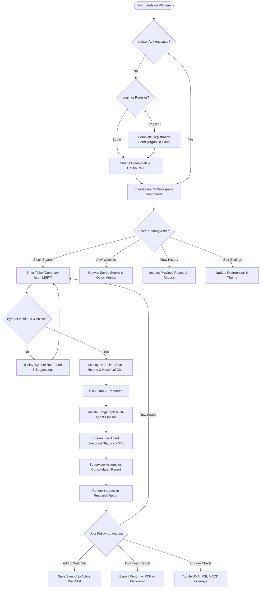
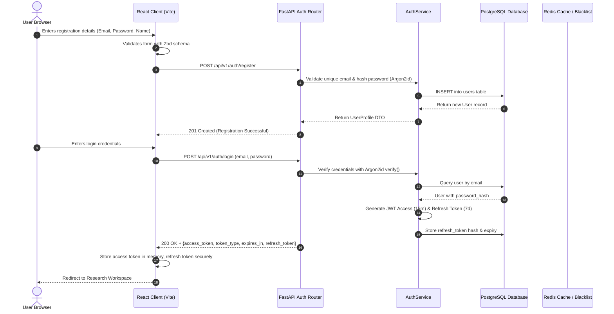
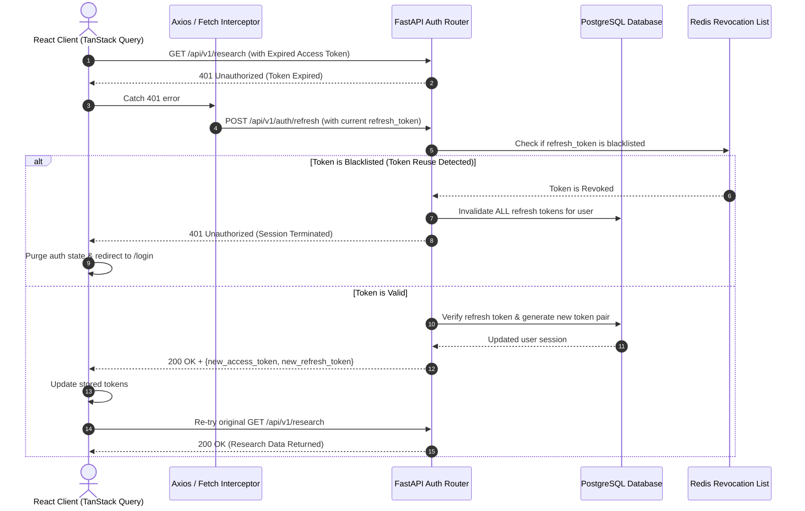
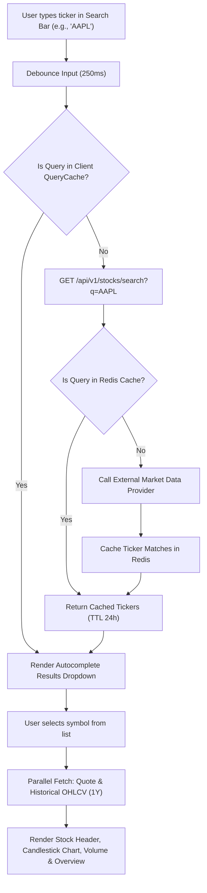
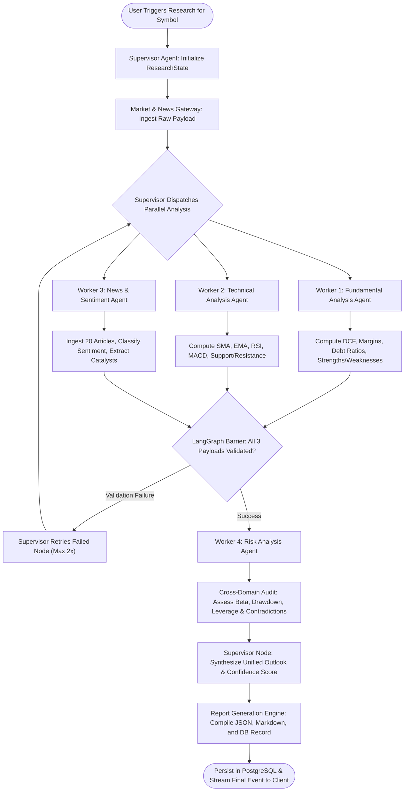
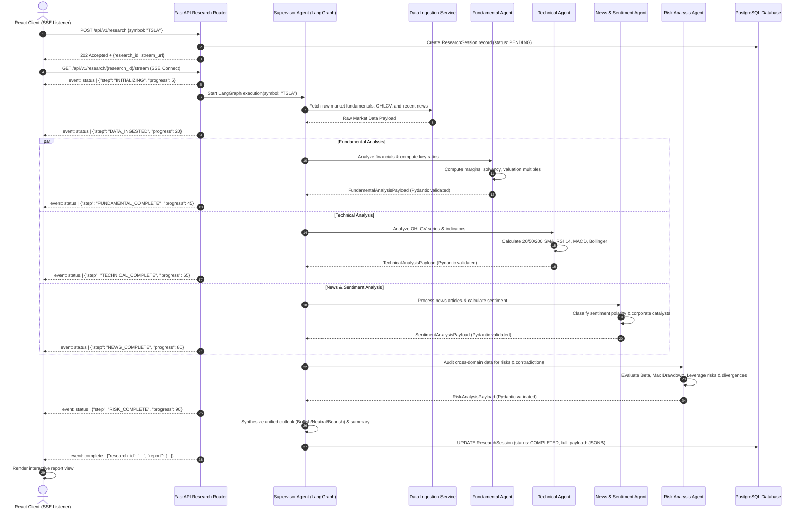
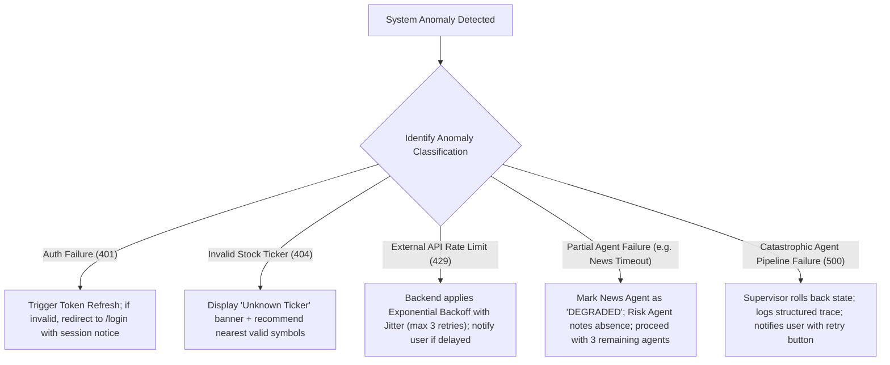

# FLOWS AND USER STORIES: AI-Powered Multi-Agent System
**Document Identifier:** FLOW-US-MASRA-V1.0  
**Status:** Approved Specification  
**Classification:** Behavioral Flows, Interaction Models & Agile Stories  

---

## 1. End-to-End System & User Journey

The following diagram illustrates the complete user journey from an unauthenticated visitor to an informed investor utilizing multi-agent research outputs.

---

## 2. Detailed Interaction & System Flows

### 2.1 User Registration and Authentication Flow

### 2.2 JWT Token Refresh Lifecycle Flow

---

## 3. Stock Search & Market Data Ingestion Workflow

---

## 4. Multi-Agent Research Execution Architecture & Sequence

### 4.1 Multi-Agent State Machine Architecture

### 4.2 Agent Execution & Communication Sequence

---

## 5. Detailed User Stories and Acceptance Criteria

### 5.1 Epic: Authentication & Profile Management

#### US-AUTH-01: User Registration
**As a** new investor,  
**I want** to register an account using my email and a secure password,  
**So that** I can maintain my personal research history and access customized watchlists.

- **Acceptance Criteria:**
  - *Given* an unregistered visitor on the registration screen,
  - *When* they submit a valid email, name, and strong password (>= 8 chars, 1 uppercase, 1 lowercase, 1 number, 1 symbol),
  - *Then* the backend creates an account using **Argon2id** password hashing and returns HTTP 201 Created.
  - *When* they submit an existing email,
  - *Then* the backend returns HTTP 409 Conflict with message `"An account with this email already exists."`

#### US-AUTH-02: User Login & Session Handling
**As a** registered user,  
**I want** to securely log in with my email and password,  
**So that** I can access my protected workspace and saved analyses.

- **Acceptance Criteria:**
  - *Given* a registered user with valid credentials,
  - *When* they submit the login form,
  - *Then* the server returns a JWT access token valid for 15 minutes and a refresh token valid for 7 days.
  - *And* the client transparently refreshes the access token in the background before expiration.
  - *When* invalid credentials are submitted,
  - *Then* the server returns HTTP 401 Unauthorized with generic message `"Invalid email or password."`

---

### 5.2 Epic: Stock Exploration & Interactive Dashboards

#### US-STOCK-01: Real-Time Stock Search with Autocomplete
**As an** equity analyst,  
**I want** to type a company name or ticker symbol and receive instant suggestions,  
**So that** I can quickly locate any publicly traded US company without memorizing ticker symbols.

- **Acceptance Criteria:**
  - *Given* an authenticated user in the research workspace,
  - *When* they type 2 or more characters into the search bar,
  - *Then* a debounced (250ms) query queries `/api/v1/stocks/search`, returning matched tickers, company names, and exchanges in < 150ms.
  - *And* keyboard navigation (Arrow Down, Arrow Up, Enter) allows selecting a result directly.

#### US-STOCK-02: Interactive Candlestick and Indicator Charting
**As a** technical trader,  
**I want** to inspect historical candlestick price charts and toggle indicators (SMA, EMA, RSI, MACD),  
**So that** I can visually verify price momentum and key support/resistance levels.

- **Acceptance Criteria:**
  - *Given* a selected stock (e.g., "AAPL"),
  - *When* the stock dashboard loads,
  - *Then* a candlestick chart renders 1 year of daily historical price action at 60fps.
  - *When* the user toggles the "200-day SMA" checkbox,
  - *Then* the moving average line smoothly renders over the price candlesticks.
  - *When* hovering over any candle, a tooltip displays Date, Open, High, Low, Close, and Volume.

---

### 5.3 Epic: Multi-Agent AI Research Execution

#### US-AGENT-01: Triggering Automated Multi-Agent Research
**As an** investor,  
**I want** to click "Run AI Research" on any selected stock,  
**So that** five specialized AI agents autonomously analyze the company's fundamentals, technicals, news, and risks.

- **Acceptance Criteria:**
  - *Given* a valid selected equity on the dashboard,
  - *When* the user clicks "Run AI Research",
  - *Then* the backend initiates a LangGraph execution session and returns a session ID within 500ms.
  - *And* an SSE connection streams status events for each agent (`Fundamental`, `Technical`, `News`, `Risk`).
  - *And* the entire execution finishes in under 60 seconds with 100% Pydantic-validated payload.

#### US-AGENT-02: Fundamental Health Analysis & Valuation
**As a** value investor,  
**I want** the Fundamental Analysis Agent to examine balance sheets, income statements, and cash flows,  
**So that** I know whether the company is financially solvent, growing profitably, and fairly valued.

- **Acceptance Criteria:**
  - *Given* an active research session,
  - *When* the Fundamental Agent runs,
  - *Then* it computes Gross Margin, Operating Margin, Net Margin, Current Ratio, Debt-to-Equity, FCF Yield, and P/E ratios deterministically.
  - *And* it outputs structured qualitative lists of top 3 Fundamental Strengths and top 3 Fundamental Weaknesses.

#### US-AGENT-03: Real-Time News & Sentiment Analysis
**As an** active trader,  
**I want** the News and Sentiment Agent to aggregate recent corporate news and calculate polarity,  
**So that** I can gauge current market sentiment and identify upcoming corporate catalysts.

- **Acceptance Criteria:**
  - *Given* an active research session,
  - *When* the News & Sentiment Agent runs,
  - *Then* it ingests the 20 most recent news articles for the ticker.
  - *And* it outputs a composite sentiment score between -1.0 (Extremely Bearish) and +1.0 (Extremely Bullish).
  - *And* it highlights key catalysts (earnings dates, management changes, product launches).

#### US-AGENT-04: Adversarial Risk & Contradiction Detection
**As a** risk manager,  
**I want** the Risk Analysis Agent to cross-examine technical, fundamental, and news findings,  
**So that** I am alerted to conflicting signals (e.g., surging price momentum despite surging debt).

- **Acceptance Criteria:**
  - *Given* completed fundamental, technical, and news agent payloads,
  - *When* the Risk Analysis Agent executes,
  - *Then* it identifies any divergence between technical indicators and fundamental health.
  - *And* it categorizes overall risk into Low, Moderate, High, or Critical with clear justification.
  - *And* it quantifies Beta, historical volatility, and Maximum Drawdown over the past 12 months.

---

### 5.4 Epic: Research Report Synthesis, History & Export

#### US-REPORT-01: Viewing Synthesized Research Dossier
**As a** research analyst,  
**I want** to read a unified research report with an executive summary, multi-factor score, and drill-down tabs,  
**So that** I can quickly grasp the overall thesis and inspect deep agent findings on demand.

- **Acceptance Criteria:**
  - *Given* a completed research execution,
  - *When* the report viewer loads,
  - *Then* it prominently features the Synthesized Signal (e.g., "Bullish (Confidence 82%)") and Executive Summary.
  - *And* clickable tabs permit drilling down into Fundamental, Technical, News/Sentiment, and Risk details.
  - *And* every metric displays a tooltip showing origin source and timestamp.

#### US-REPORT-02: Downloading Reports in Markdown and PDF
**As a** wealth advisor,  
**I want** to export the research report as a clean Markdown or PDF file,  
**So that** I can archive it offline, share it with colleagues, or attach it to client correspondence.

- **Acceptance Criteria:**
  - *Given* a completed research report in the viewer,
  - *When* the user clicks "Export as Markdown",
  - *Then* the client downloads a `.md` file containing standard Markdown tables, bold headers, and disclaimers.
  - *When* the user clicks "Export as PDF",
  - *Then* a formatted, printable PDF document is downloaded with high-resolution tables and clean page breaks.

---

### 5.5 Epic: Watchlists & Organization

#### US-WATCH-01: Managing Custom Watchlists
**As an** active investor,  
**I want** to save interesting stocks to a watchlist with real-time price updates and last research timestamps,  
**So that** I can monitor my favorite candidates and re-run research periodically.

- **Acceptance Criteria:**
  - *Given* an authenticated user viewing a stock,
  - *When* they click "Add to Watchlist",
  - *Then* the stock is appended to their default watchlist and confirmed via a non-intrusive toast notification.
  - *When* viewing the Watchlist dashboard,
  - *Then* all saved stocks display Current Price, Daily % Change, and Last Research Date.
  - *And* the user can remove any symbol with a single click.

---

## 6. Error Handling & Recovery Workflows

The application handles anomalies gracefully across all tiers:

