# IMPLEMENTATION PHASES AND MASTER ROADMAP
**Project Title:** AI-Powered Multi-Agent System for Market Analysis and Research  
**Document Identifier:** ROADMAP-MASRA-V1.0  
**Status:** Approved Engineering Plan  
**Target Milestone:** Version 1.0.0-GA  
**Estimation Model:** Relative Development Sizing (Story Points & Person-Weeks)  

---

## 1. Master Milestone Overview

The development lifecycle is divided into **9 logical, sequential phases** designed to mitigate technical risk early, isolate deterministic mathematical modules before agent reasoning, and culminate in an institutional-grade production system.

```mermaid
flowchart LR
    P1["Phase 1: Project Foundation"] --> P2["Phase 2: Auth & Workspace"]
    P2 --> P3["Phase 3: Market Data Engine"]
    P3 --> P4["Phase 4: Specialized AI Agents"]
    P4 --> P5["Phase 5: LangGraph Orchestration"]
    P5 --> P6["Phase 6: Report Generation & Export"]
    P6 --> P7["Phase 7: Dashboard & UI Polish"]
    P7 --> P8["Phase 8: Testing & Hardening"]
    P8 --> P9["Phase 9: Production Deployment"]
```

---

## 2. Master Milestone Schedule & Effort Estimation

*Note: All estimates use relative effort sizing (Person-Weeks = PW; Story Points = SP) assuming a team of 1 Senior Full-Stack Engineer, 1 AI/Backend Engineer, and 1 UI/UX Frontend Engineer.*

| Milestone Code | Phase Name | Primary Focus | Relative Effort | Cumulative Effort | Prerequisite Phases |
| :---: | :--- | :--- | :---: | :---: | :---: |
| **M1** | **Phase 1: Foundation** | Tooling, Docker, DB, Base Repos | 2 PW (20 SP) | 2 PW | None |
| **M2** | **Phase 2: Auth & Workspace** | JWT, Argon2id, Profile, Watchlist Shell | 3 PW (32 SP) | 5 PW | Phase 1 |
| **M3** | **Phase 3: Market Data Engine** | Providers, Caching, Indicator Math | 3 PW (30 SP) | 8 PW | Phase 1 |
| **M4** | **Phase 4: Individual AI Agents** | Fundamental, Tech, News, Risk Prompts | 4 PW (45 SP) | 12 PW | Phase 3 |
| **M5** | **Phase 5: LangGraph Multi-Agent** | StateGraph, Supervisor, SSE Streaming | 4 PW (40 SP) | 16 PW | Phase 4 |
| **M6** | **Phase 6: Report Generation** | Synthesis, Citations, PDF/MD Export | 3 PW (28 SP) | 19 PW | Phase 5 |
| **M7** | **Phase 7: Dashboard Integration** | TradingView Charts, Polish, Toasts | 3 PW (26 SP) | 22 PW | Phases 2, 6 |
| **M8** | **Phase 8: QA & Security Audit** | Unit/Agent/Load Testing, Hardening | 3 PW (30 SP) | 25 PW | Phase 7 |
| **M9** | **Phase 9: Production Deployment** | CI/CD, Containerization, Monitoring | 2 PW (18 SP) | 27 PW | Phase 8 |

---

## 3. Detailed Phase Breakdown

---

### Phase 1: Project Foundation & Architecture Setup
- **Objectives:** Establish the version control repository, containerized local development environment, base database schema, and project scaffold for both frontend and backend.
- **Detailed Tasks:**
  1. Initialize Git repository with branch protections, `.gitignore`, and Conventional Commit hooks.
  2. Configure Docker Compose for PostgreSQL 16 and Redis 7.
  3. Scaffold FastAPI application structure, Alembic migration environment, and health check endpoints (`/api/v1/health`).
  4. Scaffold React 18+ Vite frontend with TypeScript, Tailwind CSS, and core design token variables.
  5. Establish shared linting and formatting tooling (Ruff, Black, Mypy, ESLint, Prettier).
- **Dependencies:** None.
- **Deliverables:** Working Dockerized dev environment, passing health check endpoint, clean frontend home screen.
- **Acceptance Criteria:** `docker compose up` starts PostgreSQL, Redis, backend, and frontend without errors; `/docs` renders Swagger UI.
- **Estimated Effort:** 2 Person-Weeks (20 Story Points).
- **Risks & Mitigation:** Divergent team Python/Node versions; mitigated via `.nvmrc` and strict Docker images.
- **Definition of Done (DoD):** CI pipeline builds both images cleanly; local dev boots with one command.

---

### Phase 2: User Authentication and Research Workspace
- **Objectives:** Implement secure user registration, login, session management, and the user workspace data layer.
- **Detailed Tasks:**
  1. Implement User and RefreshToken models in SQLAlchemy with Alembic migration.
  2. Build Argon2id password hashing and PyJWT token generation/verification services.
  3. Create auth endpoints: `/register`, `/login`, `/refresh`, `/logout`, `/me`.
  4. Build React client authentication state (React Context + TanStack Query), login/register forms with Zod validation.
  5. Create protected route wrappers in React Router with automatic token refresh interceptor.
  6. Scaffold database models and endpoints for Watchlists and Research Sessions history.
- **Dependencies:** Phase 1 complete.
- **Deliverables:** Fully functional user authentication system, protected workspace shell, and watchlist CRUD API.
- **Acceptance Criteria:** Unauthenticated users cannot access `/workspace`; expired access tokens refresh transparently; refresh token reuse triggers immediate session revocation.
- **Estimated Effort:** 3 Person-Weeks (32 Story Points).
- **Risks & Mitigation:** Token race conditions during concurrent API requests; mitigated via mutex locking in Axios/fetch interceptor.
- **Definition of Done (DoD):** Unit and integration test coverage for authentication exceeds 95%.

---

### Phase 3: Stock Market Data Integration & Technical Math Engine
- **Objectives:** Integrate external financial data APIs, establish Redis caching layers, and implement a pure, deterministic mathematical indicator engine.
- **Detailed Tasks:**
  1. Build `MarketDataService` abstracting external APIs (Alpha Vantage, Polygon.io, Yahoo Finance).
  2. Implement Redis caching layer with distinct TTLs (15 min for quotes, 24 hr for financials).
  3. Implement ticker symbol search and typeahead autocomplete endpoint (`/api/v1/stocks/search`).
  4. Build deterministic `TechnicalCalcService` using `numpy` and `pandas` for SMA (20, 50, 200), EMA (12, 26), RSI (14), MACD, and Bollinger Bands.
  5. Implement historical price retrieval endpoint (`/api/v1/stocks/{symbol}/history`).
- **Dependencies:** Phase 1 complete.
- **Deliverables:** Verified market data gateway, fast symbol search, and 100% deterministic technical indicator calculation suite.
- **Acceptance Criteria:** Autocomplete responds in < 150ms; mathematical indicator calculations match standard TA-Lib benchmarks with 0.0001 precision.
- **Estimated Effort:** 3 Person-Weeks (30 Story Points).
- **Risks & Mitigation:** Third-party rate limit throttling; mitigated via aggressive Redis caching and exponential backoff retry policies.
- **Definition of Done (DoD):** Comprehensive pytest suite covering all indicator mathematical edge cases.

---

### Phase 4: Individual AI Research Agents
- **Objectives:** Design, prompt-engineer, and validate the four specialized worker agents with strict Pydantic output schemas.
- **Detailed Tasks:**
  1. Build **Fundamental Analysis Agent**: prompts and Pydantic models for revenue trends, margins, solvency, and strengths/weaknesses.
  2. Build **Technical Analysis Agent**: prompt that interprets deterministic indicator outputs and identifies key support/resistance zones.
  3. Build **News and Sentiment Agent**: news article ingestion, entity-level sentiment scoring (-1.0 to +1.0), and corporate catalyst extraction.
  4. Build **Risk Analysis Agent**: adversarial prompt that ingests intermediate outputs, calculates Beta/drawdown risk, and surfaces contradictions.
  5. Configure LLM provider abstraction layer (OpenAI GPT-4o, Anthropic Claude 3.5 Sonnet, Google Gemini).
- **Dependencies:** Phase 3 complete.
- **Deliverables:** Four independently executable agents with verified structured JSON outputs.
- **Acceptance Criteria:** 100% of agent outputs conform to strict Pydantic schemas; zero arithmetic hallucinations in financial ratios.
- **Estimated Effort:** 4 Person-Weeks (45 Story Points).
- **Risks & Mitigation:** LLM schema validation failures; mitigated using native `.with_structured_output()` and retry fallbacks.
- **Definition of Done (DoD):** Golden dataset of 10 test equities runs through each agent with consistent, high-quality reasoning.

---

### Phase 5: LangGraph Multi-Agent Orchestration
- **Objectives:** Assemble the Supervisor Agent and worker agents into an asynchronous LangGraph `StateGraph` with real-time SSE progress streaming.
- **Detailed Tasks:**
  1. Define `ResearchState` TypedDict schema capturing all inputs, states, logs, and outputs.
  2. Implement `SupervisorNode` to initialize state, coordinate parallel worker dispatch, and validate outputs.
  3. Construct LangGraph graph with parallel branches for Fundamental, Technical, and News agents joining at a barrier before the Risk Agent.
  4. Implement Server-Sent Events (SSE) streaming endpoint (`/api/v1/research/{id}/stream`) to emit real-time agent lifecycle events.
  5. Build frontend `AgentExecutionPipeline` component to visualize live agent execution progress.
- **Dependencies:** Phases 3 and 4 complete.
- **Deliverables:** Stateful multi-agent graph with real-time streaming telemetry.
- **Acceptance Criteria:** Full graph executes in under 60 seconds; user sees visual real-time progress steps for each agent; partial failures degrade gracefully.
- **Estimated Effort:** 4 Person-Weeks (40 Story Points).
- **Risks & Mitigation:** SSE connection drops on mobile or unstable networks; mitigated via reconnection logic and persistent database session state.
- **Definition of Done (DoD):** 50 consecutive automated graph runs complete with zero deadlocks or unhandled exceptions.

---

### Phase 6: Research Report Generation & Export Engine
- **Objectives:** Compile multi-agent payloads into structured research reports, complete with source citations, visual charts, and export capabilities.
- **Detailed Tasks:**
  1. Implement synthesis logic in the Supervisor Agent: multi-factor overall rating (Bullish to Bearish) and confidence score calculation.
  2. Create `ReportService` to compile the final JSON report into GitHub-flavored Markdown.
  3. Implement PDF generation engine (headless browser or WeasyPrint) with clean page breaks, charts, and header formatting.
  4. Enforce mandatory regulatory research disclaimers and source attribution timestamps.
  5. Create report endpoints: `/api/v1/reports/{id}`, `/api/v1/reports/{id}/download`.
- **Dependencies:** Phase 5 complete.
- **Deliverables:** Structured report viewer, Markdown download, and printable PDF export.
- **Acceptance Criteria:** Exported Markdown and PDF match UI data exactly; all metrics display source and timestamp badges.
- **Estimated Effort:** 3 Person-Weeks (28 Story Points).
- **Risks & Mitigation:** PDF rendering font and chart distortion; mitigated using standardized print CSS styling.
- **Definition of Done (DoD):** Generated PDFs print cleanly across standard letter and A4 page sizes.

---

### Phase 7: Dashboard and User Experience Polish
- **Objectives:** Integrate all frontend modules into a cohesive, high-density financial terminal interface.
- **Detailed Tasks:**
  1. Integrate TradingView Lightweight Charts with candlestick data and interactive SMA overlays.
  2. Implement `MetricCard`, `FinancialRatioGrid`, `SentimentGauge`, and `RiskMatrix` components.
  3. Build full `WatchlistTable` with real-time quote updates and quick research triggers.
  4. Build `ResearchHistoryTable` with search, filtering, and report re-opening.
  5. Implement dark/light mode toggle with CSS variable transitions and responsive mobile drawer.
- **Dependencies:** Phases 2, 3, and 6 complete.
- **Deliverables:** Complete, polished, and responsive web application frontend.
- **Acceptance Criteria:** Dashboard passes WCAG 2.1 AA accessibility audit; 60fps chart rendering; zero layout shifts.
- **Estimated Effort:** 3 Person-Weeks (26 Story Points).
- **Risks & Mitigation:** UI performance lag on heavy data tables; mitigated via virtualized rendering (`TanStack Virtual`).
- **Definition of Done (DoD):** Lighthouse score > 90 across Performance, Accessibility, and Best Practices.

---

### Phase 8: Testing and Quality Assurance
- **Objectives:** Execute comprehensive test suites, security assessments, and performance stress testing.
- **Detailed Tasks:**
  1. Write backend integration tests for all API endpoints and authentication edge cases.
  2. Execute LangGraph workflow failure-injection tests (simulate API timeouts, rate limits, bad tickers).
  3. Conduct security review: verify Argon2id parameters, JWT expiry, SQL injection immunity, and CORS headers.
  4. Perform load testing with Locust or k6: 50 concurrent research sessions and 200 concurrent API users.
  5. Run frontend cross-browser testing (Chrome, Safari, Firefox, Edge) and responsive mobile checks.
- **Dependencies:** Phase 7 complete.
- **Deliverables:** Automated test reports, security audit signoff, and load testing benchmark reports.
- **Acceptance Criteria:** Test coverage > 85% across critical backend code; p90 API latency < 200ms (excluding external LLM call).
- **Estimated Effort:** 3 Person-Weeks (30 Story Points).
- **Risks & Mitigation:** High API costs during load testing; mitigated by using mock LLM endpoints for high-throughput stress tests.
- **Definition of Done (DoD):** Zero critical or high-severity vulnerabilities in security scan.

---

### Phase 9: Deployment and Production Readiness
- **Objectives:** Package the application for production, configure CI/CD automation, set up structured logging, and finalize documentation.
- **Detailed Tasks:**
  1. Create multi-stage production Dockerfiles for frontend (Nginx) and backend (Uvicorn).
  2. Setup GitHub Actions CI/CD pipeline (lint, test, build, push container images).
  3. Configure production environment configuration with secret management.
  4. Implement structured JSON logging, Prometheus metrics endpoint, and error tracking.
  5. Finalize developer documentation, API references, and system handoff guides.
- **Dependencies:** Phase 8 complete.
- **Deliverables:** Production-ready container images, automated deployment pipeline, operational runbook.
- **Acceptance Criteria:** Zero downtime deployments; health check monitors container status; structured logs stream to aggregation sink.
- **Estimated Effort:** 2 Person-Weeks (18 Story Points).
- **Risks & Mitigation:** Production database migration failures; mitigated by running dry-run migrations in staging environment.
- **Definition of Done (DoD):** Staging environment fully operational and passing automated smoke tests.

