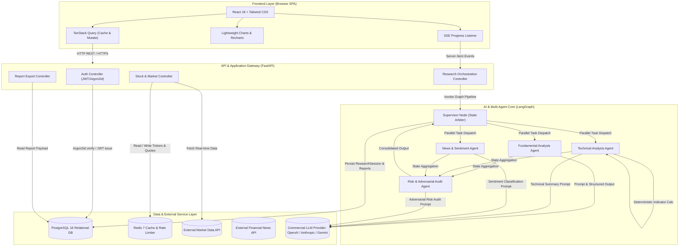

# TECHNICAL STACK SPECIFICATION
**Project Title:** AI-Powered Multi-Agent System for Market Analysis and Research  
**Document Identifier:** TECH-STACK-MASRA-V1.0  
**Status:** Approved Architectural Blueprint  
**Classification:** System Architecture, Frameworks & Infrastructure  

---

## 1. Master Technology Stack Matrix

The platform is designed around a modern, asynchronous, type-safe architecture separating fast client interaction from deterministic quantitative calculations and stateful multi-agent reasoning.

| Tier / Domain | Technology | Version | Primary Purpose | Justification & Architectural Advantage |
| :--- | :--- | :--- | :--- | :--- |
| **Frontend Framework** | **React.js** | 18.3+ / 19.x | Single Page Application (SPA) | Component-driven architecture, vast financial charting ecosystem, virtual DOM performance. |
| **Language (Client)** | **TypeScript** | 5.4+ | Type safety & developer velocity | Shared DTO contracts with backend schemas; eliminates runtime property errors. |
| **Build Tooling** | **Vite** | 5.3+ | Bundler & local dev server | Instant hot module replacement (HMR), optimized Rollup tree-shaking for lean production bundles. |
| **Styling & Design** | **Tailwind CSS** | 3.4+ | Utility-first styling system | High development speed, unified design token configuration, zero runtime CSS overhead. |
| **Client State / Cache** | **TanStack Query** | 5.40+ | Server state & query cache | Built-in deduplication, optimistic updates, automatic background refetching and stale time control. |
| **Client Routing** | **React Router** | 6.24+ | Declarative SPA navigation | Protected routes, nested layouts, scroll restoration, and URL query parameter management. |
| **Form Handling** | **React Hook Form + Zod** | 7.52+ / 3.23+ | Form validation & parsing | Performant uncontrolled inputs, schema-driven validation matching backend Pydantic models. |
| **Financial Charting** | **TradingView Lightweight Charts** + **Recharts** | 4.2+ / 2.12+ | Candlesticks, volume & analytics | High-performance HTML5 canvas for candlestick/OHLCV series; SVG-based Recharts for gauges & ratios. |
| **Backend Runtime** | **Python** | 3.11+ | Asynchronous backend runtime | Standard language for financial modeling, native math libraries (`pandas`, `numpy`), first-class LLM SDKs. |
| **Backend Framework** | **FastAPI** | 0.111+ | Asynchronous REST & SSE API | Native `asyncio`, automatic OpenAPI 3.1 Swagger docs, high throughput, tight Pydantic v2 integration. |
| **Data Validation** | **Pydantic** | 2.7+ | Request/response DTOs & agent output | Rust-backed performance (10x faster than v1), strict type coercion, JSON Schema generation for LLMs. |
| **Multi-Agent Engine** | **LangGraph** | 0.1.0+ | Stateful agent workflow graph | Cyclic state machines, persistent checkpointing, human-in-the-loop readiness, deterministic routing. |
| **LLM Orchestration** | **LangChain Core** | 0.2.0+ | Model interfaces & prompt templates | Unified abstraction across OpenAI, Anthropic, and Google Gemini; tool calling standards. |
| **Relational Database** | **PostgreSQL** | 16.2+ | Primary relational datastore | ACID transactions, rich JSONB support for agent telemetry, high reliability, robust indexing. |
| **Database ORM** | **SQLAlchemy** (Async) | 2.0.30+ | Object relational mapper | Modern `asyncpg` engine integration, type annotations, expressive SQL query construction. |
| **Schema Migrations** | **Alembic** | 1.13+ | Database schema versioning | Declarative migration scripts, automated autogenerate detection, auditable revision history. |
| **In-Memory Cache** | **Redis** | 7.2+ | Market quote cache & rate limiting | Sub-millisecond key-value caching, Pub/Sub event broadcasting, sliding-window rate limit counters. |
| **Authentication** | **Argon2id** (`argon2-cffi`) + **PyJWT** | 23.1+ / 2.8+ | Password hashing & JWT issuance | Cryptographically secure memory-hard password hashing (OWASP standard); tamper-proof stateless tokens. |
| **Math & Indicators** | **pandas** + **numpy** | 2.2+ / 1.26+ | Technical & fundamental calculations | Deterministic, vector-accelerated calculations of SMA, EMA, RSI, MACD, Sharpe, Beta, and ratios. |
| **HTTP Client** | **httpx** | 0.27+ | Asynchronous external API calls | Native `async`/`await` support, HTTP/2 support, connection pooling, and timeout management. |
| **Containerization** | **Docker & Docker Compose** | 26.0+ / 2.27+ | Local & production packaging | Multi-stage slim container builds, reproducible environments across Windows, Linux, and macOS. |
| **Testing** | **pytest** + **Vitest** | 8.2+ / 1.6+ | Backend and frontend test runners | Async pytest fixtures, Mock LLM interceptors; fast ESM-native client unit and component testing. |

---

## 2. System Architecture & Component Interaction

The platform is divided into four tightly integrated layers:



---

## 3. Communication Protocol: React, FastAPI, LangGraph, and PostgreSQL

The interaction between client, backend server, state graph, and persistent storage follows a strict lifecycle:

```mermaid
sequenceDiagram
    autonumber
    actor User as Client Browser (React + TanStack)
    participant API as FastAPI REST Gateway
    participant Redis as Redis Cache
    participant Ext as External Market Providers
    participant Graph as LangGraph Engine
    participant LLM as LLM Provider
    participant DB as PostgreSQL Database

    User->>API: POST /api/v1/research {symbol: "GOOGL"} (with Bearer JWT)
    API->>API: Validate user permissions & rate limit (Redis)
    API->>DB: INSERT INTO research_sessions (user_id, symbol, status='PENDING')
    DB-->>API: Return research_id
    API-->>User: 202 Accepted {research_id, stream_url: "/api/v1/research/{id}/stream"}

    User->>API: GET /api/v1/research/{research_id}/stream (SSE Connection)
    API-->>User: SSE event: status {"step": "INITIALIZED", "progress": 5}

    API->>Ext: Asynchronously fetch quotes, financials, OHLCV, and news
    Ext-->>API: Raw market data payload
    API->>Redis: Cache raw payload (TTL 1 hour)
    API-->>User: SSE event: status {"step": "MARKET_DATA_ACQUIRED", "progress": 20}

    API->>Graph: Execute StateGraph(ResearchState)
    Graph->>Graph: Dispatch Fundamental, Technical, and News nodes concurrently
    
    par Concurrency
        Graph->>LLM: Fundamental analysis prompt with financial tables
        LLM-->>Graph: Structured Fundamental JSON
        API-->>User: SSE event: status {"step": "FUNDAMENTAL_DONE", "progress": 45}
    and
        Graph->>Graph: Run deterministic numpy/pandas technical indicators (SMA, RSI, MACD)
        Graph->>LLM: Technical interpretation prompt
        LLM-->>Graph: Structured Technical JSON
        API-->>User: SSE event: status {"step": "TECHNICAL_DONE", "progress": 65}
    and
        Graph->>LLM: News sentiment scoring & catalyst extraction prompt
        LLM-->>Graph: Structured News Sentiment JSON
        API-->>User: SSE event: status {"step": "NEWS_DONE", "progress": 80}
    end

    Graph->>LLM: Risk Agent prompt (Auditing all 3 agent outputs for divergences)
    LLM-->>Graph: Structured Risk JSON
    API-->>User: SSE event: status {"step": "RISK_AUDIT_DONE", "progress": 90}

    Graph->>Graph: Supervisor node generates composite score & executive synthesis
    Graph-->>API: Complete final ResearchState
    
    API->>DB: INSERT INTO research_reports (research_session_id, report_json, rating)
    API->>DB: UPDATE research_sessions SET status='COMPLETED'
    
    API-->>User: SSE event: complete {"research_id": "...", "report": {...}}
    User->>User: TanStack Query sets cache; UI renders full interactive report
```

---

## 4. Frontend Architecture Specification

### 4.1 Architecture & Directory Layout
The frontend is a modular, component-driven Single Page Application built on React 18+ and TypeScript, organized according to feature-based domain modules:

```text
frontend/src/
├── app/
│   ├── router.tsx                # React Router v6 route definitions & layout wrappers
│   ├── providers.tsx             # TanStack Query Client, AuthProvider, ThemeProvider
│   └── App.tsx                   # Top-level application component
├── assets/                       # Static SVGs, branding icons, font files
├── components/                   # Global, domain-agnostic UI primitives (Design System)
│   ├── ui/                       # Buttons, inputs, modals, cards, badges, tooltips
│   ├── layout/                   # AppLayout, TopNav, SidebarNav, Footer
│   ├── feedback/                 # Skeletons, ErrorBoundary, EmptyState, Toast
│   └── charts/                   # Recharts wrappers & TradingView chart wrappers
├── features/                     # Domain-specific modules (Atomic feature pods)
│   ├── auth/                     # LoginForm, RegisterForm, useAuth, authService
│   ├── dashboard/                # MetricCards, QuickSearch, DashboardOverview
│   ├── stock-search/             # StockSearchBar, AutocompleteList, useStockSearch
│   ├── research/                 # AgentProgressStreamer, ReportViewer, ExecutiveSummary
│   ├── charts/                   # CandlestickChart, TechnicalIndicatorToggles
│   ├── watchlists/               # WatchlistTable, QuickAddModal, useWatchlists
│   └── history/                  # ResearchHistoryTable, HistoryFilterBar
├── hooks/                        # Custom reusable React hooks (useDebounce, useSSE)
├── lib/                          # Utility libraries (axios client, formatters, cn helper)
├── types/                        # Global TypeScript interfaces & Pydantic-mirrored DTOs
└── styles/                       # Tailwind globals, CSS variables, typography imports
```

### 4.2 State Management Strategy
1. **Server State (TanStack Query):** Handles all asynchronous HTTP and SSE data fetching, caching, deduplication, and invalidation (e.g., market quotes, watchlists, research history).
2. **Client State (React Context / Lightweight Store):** Handles purely transient UI state, such as active navigation collapse, active indicator toggles (SMA 50, RSI 14), and dark/light mode toggles.
3. **Form State (React Hook Form + Zod):** Manages form inputs with zero-re-render performance, validating client data against strict Zod schemas before submission.

### 4.3 Charting Engine Evaluation: TradingView vs. Recharts
To maximize performance and user experience, the system implements a **hybrid charting strategy**:
- **TradingView Lightweight Charts (HTML5 Canvas):** Selected for the primary historical price chart (Candlesticks, OHLCV, Volume bars, Moving Average overlays). Why? Canvas-based rendering effortlessly handles 5,000+ data points at 60fps with native pinch-to-zoom, crosshairs, and time-scale panning.
- **Recharts (SVG-based):** Selected for secondary analytical visualizations: sentiment breakdown gauges, financial ratio bar charts, historical margin trends, and risk radar charts. Why? Declarative React component integration, responsive scaling, and rich CSS styling flexibility.

---

## 5. Backend Architecture Specification

### 5.1 Architecture & Directory Layout
The backend is an asynchronous, type-safe FastAPI service adhering to Clean Architecture principles:

```text
backend/app/
├── api/
│   └── v1/
│       ├── endpoints/            # auth.py, users.py, stocks.py, research.py, watchlists.py, reports.py
│       ├── dependencies.py       # DB session injection, JWT user resolver, rate limiters
│       └── api_router.py         # Root v1 APIRouter registering all endpoint routers
├── core/
│   ├── config.py                 # Pydantic BaseSettings (env vars, tokens, secrets)
│   ├── security.py               # Argon2id password hasher, JWT encoder/decoder
│   ├── database.py               # Async SQLAlchemy engine & async_sessionmaker
│   └── logging.py                # Structured JSON logging configuration
├── models/                       # SQLAlchemy 2.0 ORM database entity definitions
│   ├── user.py                   # User, RefreshToken, UserPreference
│   ├── stock.py                  # Stock, StockQuoteCache
│   ├── research.py               # ResearchSession, AgentExecutionRecord
│   ├── report.py                 # ResearchReport, ReportSection
│   └── watchlist.py              # Watchlist, WatchlistItem
├── schemas/                      # Pydantic v2 validation DTOs (Request & Response)
│   ├── auth.py                   # TokenResponse, LoginRequest, RegisterRequest
│   ├── stock.py                  # StockSearchDTO, OHLCVPoint, FundamentalMetricsDTO
│   ├── agent.py                  # FundamentalPayload, TechnicalPayload, RiskPayload
│   └── report.py                 # ResearchReportDTO, ExecutiveSummaryDTO
├── services/                     # Business logic and external orchestrators
│   ├── auth_service.py           # User lifecycle, session management, token issuance
│   ├── market_data_service.py    # Gateway for financial APIs with Redis caching
│   ├── technical_calc_service.py # Deterministic pandas/numpy indicator calculations
│   ├── research_orchestrator.py  # LangGraph execution trigger & SSE event publisher
│   └── report_service.py         # Markdown compiler & PDF generation service
├── agents/                       # LangGraph multi-agent implementation
│   ├── state.py                  # ResearchState TypedDict schema
│   ├── graph.py                  # StateGraph definition, conditional edges & barrier
│   ├── supervisor.py             # Supervisor node logic & arbiter
│   ├── fundamental_agent.py      # Fundamental analysis prompt & tool caller
│   ├── technical_agent.py        # Technical analysis prompt & interpreter
│   ├── news_agent.py             # News sentiment classification & catalyst parser
│   └── risk_agent.py             # Cross-domain adversarial audit node
└── db/
    └── migrations/               # Alembic version migration scripts
```

---

## 6. AI & Multi-Agent Architecture Specification

### 6.1 LangGraph State Machine Schema
The multi-agent system state is managed as a strictly typed `TypedDict` containing all inputs, intermediate agent outputs, verification flags, and final synthesized intelligence:

```python
from typing import TypedDict, List, Dict, Any, Optional
from pydantic import BaseModel

class ResearchState(TypedDict):
    # Context & Request Information
    research_id: str
    symbol: str
    user_id: str
    company_name: str
    
    # Ingested Market & News Raw Data
    raw_quote: Dict[str, Any]
    raw_financials: Dict[str, Any]
    raw_ohlcv: List[Dict[str, Any]]
    raw_news: List[Dict[str, Any]]
    
    # Worker Agent Output Payloads (Pydantic-validated dictionaries)
    fundamental_analysis: Optional[Dict[str, Any]]
    technical_analysis: Optional[Dict[str, Any]]
    news_sentiment_analysis: Optional[Dict[str, Any]]
    
    # Audit & Cross-Domain Analysis
    risk_analysis: Optional[Dict[str, Any]]
    detected_contradictions: List[str]
    
    # Final Synthesis & Meta
    overall_rating: Optional[str] # "Bullish", "Cautiously Bullish", "Neutral", "Cautiously Bearish", "Bearish"
    confidence_score: Optional[float] # 0.0 to 1.0
    executive_summary: Optional[str]
    agent_execution_logs: List[Dict[str, Any]]
    errors: List[str]
```

### 6.2 Agent Role Responsibilities & Structured Outputs

```
+--------------------------------------------------------------------------------+
| AGENT RESPONSIBILITY & TOOL MATRIX                                             |
+----------------------+--------------------------+------------------------------+
| Agent Node           | Deterministic Tools Used | Structured Output Model      |
+----------------------+--------------------------+------------------------------+
| Supervisor Agent     | State validator, Arbiter | SupervisorDecisionDTO        |
| Fundamental Agent    | Financial ratio engine   | FundamentalAnalysisPayload   |
| Technical Agent      | pandas / numpy indicator | TechnicalAnalysisPayload     |
| News & Sentiment     | Article tokenizer/parser | SentimentAnalysisPayload     |
| Risk Analysis Agent  | Beta / Drawdown formula  | RiskAnalysisPayload          |
| Report Generator     | Markdown / PDF compiler  | CompleteResearchReportDTO    |
+----------------------+--------------------------+------------------------------+
```

### 6.3 LLM Provider Abstraction
To avoid vendor lock-in, the agent core accesses large language models through LangChain's standard `BaseChatModel` interface with `.with_structured_output(PydanticModel)`:
- **Default Production Provider:** Anthropic Claude 3.5 Sonnet / OpenAI GPT-4o (configured via `LLM_PROVIDER` environment variable).
- **Fallback Provider:** Google Gemini 1.5 Pro or local Ollama (Llama 3.3) for resilient offline or air-gapped development.
- **Enforcement:** Structured outputs require JSON schema compliance; all numerical values must be parsed to valid types before advancing in the graph.

---

## 7. Database & Storage Architecture

### 7.1 PostgreSQL 16 Specifications
PostgreSQL serves as the single source of truth for:
- User accounts and authentication credentials.
- Refresh token rotation records.
- Watchlists and individual stock items.
- Research sessions and agent execution event logs.
- Generated research reports (stored in relational columns and queried via `JSONB`).

### 7.2 Redis 7 Cache Architecture
Redis serves two high-frequency roles:
1. **Market Data Caching:** Third-party API quotes are cached for 15 minutes (`TTL = 900s`); financial statement data is cached for 24 hours (`TTL = 86400s`). This reduces external API costs by up to 85%.
2. **Rate Limiting & Revocation:** Token bucket counters for endpoint rate limiting and a token revocation set (`blacklist`) for immediate user logout handling.

---

## 8. Technology Selection Justification & Trade-Off Analysis

### 8.1 Backend Framework: FastAPI vs. Django / Node.js
- **FastAPI Selected:** Chosen for native `asyncio` support required for concurrent external API polling and LangGraph execution; automatic OpenAPI documentation; and seamless integration with Python's data science ecosystem (`pandas`, `numpy`, `langgraph`).
- **Django Rejected:** Heavyweight ORM lacks seamless native async; unnecessary overhead for an API-first microservice.
- **Node.js (NestJS / Express) Rejected:** While fast, Node requires running Python as a child process or separate microservice to execute LangGraph and quantitative math libraries, introducing IPC latency and operational complexity.

### 8.2 Agent Orchestration: LangGraph vs. AutoGen / CrewAI
- **LangGraph Selected:** LangGraph provides cyclic state machine modeling, explicit graph edges, deterministic checkpoints, and strict state types. Unlike conversational multi-agent frameworks, LangGraph allows deterministic control over which agents execute in parallel, when they join, and how failures are retried.
- **AutoGen / CrewAI Rejected:** AutoGen and CrewAI lean heavily on conversational multi-agent banter ("chat rooms"), which leads to high token consumption, unpredictable execution sequences, and difficulty enforcing rigid JSON schema barriers.

### 8.3 Database: PostgreSQL vs. MongoDB / DynamoDB
- **PostgreSQL Selected:** Provides strict ACID guarantees for user authentication, financial data relations, and foreign keys between users, sessions, and reports. PostgreSQL's native `JSONB` capabilities offer the exact document-store flexibility needed for agent payloads without sacrificing relational integrity.
- **MongoDB Rejected:** Lacks strict relational constraints between users, watchlists, and research sessions; requires secondary tools for relational consistency.

---

## 9. Version Compatibility Recommendations

| Component | Minimum Version | Recommended Version | Compatibility Notes |
| :--- | :--- | :--- | :--- |
| **Node.js** | 20.12.0 LTS | 20.14.0 LTS | Required for Vite 5 and modern ESM module resolution. |
| **Python** | 3.11.0 | 3.11.9 / 3.12.3 | Python 3.11+ offers 25% faster runtime execution than 3.10. |
| **PostgreSQL** | 15.0 | 16.2 | PostgreSQL 16 improves query parallelism and `JSONB` performance. |
| **Docker** | 24.0.0 | 26.1.0+ | Docker Compose v2 syntax (`docker compose`) required. |
| **Tailwind CSS** | 3.4.0 | 3.4.4 | Avoid v4 alpha until stable ecosystem plugin support is finalized. |
| **LangGraph** | 0.1.0 | 0.1.5+ | Modern StateGraph API required. |

